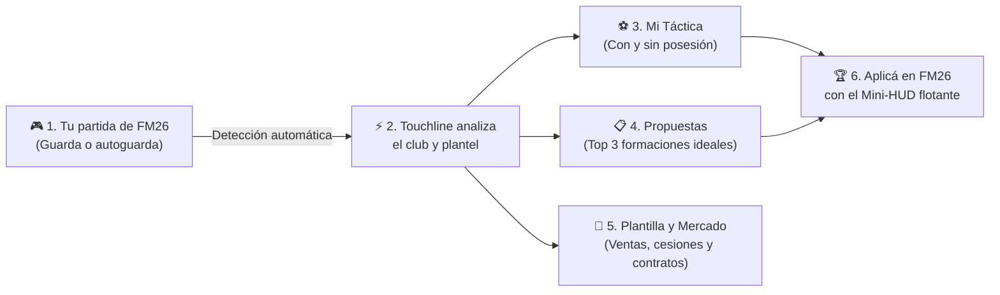
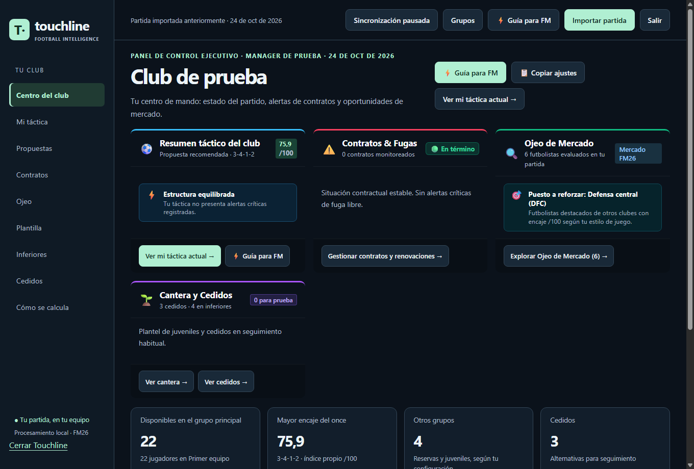

# Touchline · Analizador para Football Manager 26

**Touchline** es una aplicación de escritorio diseñada para acompañar tus partidas de **Football Manager 2026**. Te ayuda a entender a fondo el rendimiento de tu plantel, auditar y comparar propuestas tácticas con y sin pelota, gestionar contratos y tomar mejores decisiones en el mercado de pases.

---

## 🚀 Instalación en 3 pasos (Windows)

No necesitás conocimientos técnicos ni instalar programas adicionales:

1. **Descargá el instalador oficial**: Hacé clic en el botón verde de arriba o descargá [**Touchline-Analizador-FM26.msi**](https://github.com/Fede1771/Analizador-FM/releases/latest/download/Touchline-Analizador-FM26.msi) desde la sección de [Releases](https://github.com/Fede1771/Analizador-FM/releases).
2. **Hacé doble clic** en el archivo `.msi` y seguí el asistente en pantalla:
   - *No requiere permisos de Administrador (se instala en tu usuario).*
   - *No requiere instalar Python, terminales ni dependencias.*
3. **¡Listo!** Abrí la aplicación desde el acceso directo creado en tu **Escritorio** o en el **Menú Inicio**.

---

## 🗺️ Flujo de trabajo en Touchline

---

## 📖 Guía visual paso a paso

### Paso 1: Carga y sincronización automática de tu partida
Al abrir Touchline, el **Centro del Club** detecta de forma automática tus partidas en la carpeta habitual de Football Manager 26 (`Documentos\Sports Interactive\Football Manager 26\games`). Cada vez que guardes tu juego en FM26, Touchline actualiza todos los datos en segundo plano sin interrumpirte.

> **Seguridad garantizada**: Touchline nunca modifica tus archivos originales. Trabaja exclusivamente con copias temporales seguras de solo lectura en tu propia PC.

---

### Paso 2: Auditá tu once y la cobertura en dos fases
En **Mi táctica** podés ver a tus once titulares con sus dorsales, nombre, rol y encaje porcentual (0 a 100).
- **Fase con posesión (Ataque)** y **Fase sin posesión (Defensa)**: alterná entre ambas con un solo clic para observar cómo se reorganiza tu equipo según los roles asignados en FM26.
- **Mapa de calor y cobertura por zonas**: descubrí qué pasillos del campo están protegidos y qué áreas quedan descubiertas para corregir instrucciones antes del próximo partido.

---

### Paso 3: Descubrí las formaciones ideales para tus jugadores
¿Dudas sobre qué esquema le sienta mejor a tus futbolistas? En **Propuestas** el motor analiza diez estructuras tácticas diferentes y te destaca las **tres formaciones de mayor encaje**:
- Te arma automáticamente el **once titular ideal** y el **banco de suplentes** asegurando cobertura para todas las líneas.
- Podés filtrar y simular diferentes estilos: juego de posesión, contragolpe directo, presión adelantada, bloque medio, etc.

---

### Paso 4: Ajustá tu partido con la Guía Rápida Mini-HUD
Cuando estés jugando el partido en Football Manager 26, podés abrir la **Guía rápida / Mini-HUD**: una ventana compacta y flotante pensada para tener al costado de tu pantalla que resume exactamente qué instrucciones colectivas e individuales ponerle a cada jugador sin tener que memorizarlas.

---

### Paso 5: Optimizá tu plantel (Ventas, préstamos y juveniles)
En la sección **Plantilla**:
- **Recomendación de sobrepoblación**: detecta si tenés demasiados futbolistas en una misma posición y te sugiere a quién conviene vender o dar a préstamo para aligerar la masa salarial y evitar descontentos por falta de minutos.
- **Seguimiento de cedidos**: evaluá el rendimiento y situación contractual de los jugadores a préstamo en otros equipos.
- **Promoción de canteranos**: compará si tus promesas juveniles ya tienen nivel para alternar con los titulares.

---

### Paso 6: Ojeo inteligente y blindaje de contratos
- **Ojeo por necesidades tácticas**: encontrá refuerzos filtrados por posición y roles que encajen específicamente en lo que tu táctica demanda, adaptado al género de tu plantel (femenino o masculino).
- **Semáforo de contratos**: alertas automáticas con cuenta regresiva (6 y 12 meses) para renovar a tiempo y evitar que tus estrellas se marchen libres.

---

## 🔒 Privacidad y funcionamiento local

- **100 % local y privado**: Todo el procesamiento se realiza en tu equipo. Touchline no requiere conexión a internet ni envía partidas o datos a ningún servidor externo.
- **Herramienta complementaria**: Los cálculos, puntajes y recomendaciones son estimaciones analíticas propias de Touchline desarrolladas para ayudarte a tomar mejores decisiones en Football Manager 2026.
