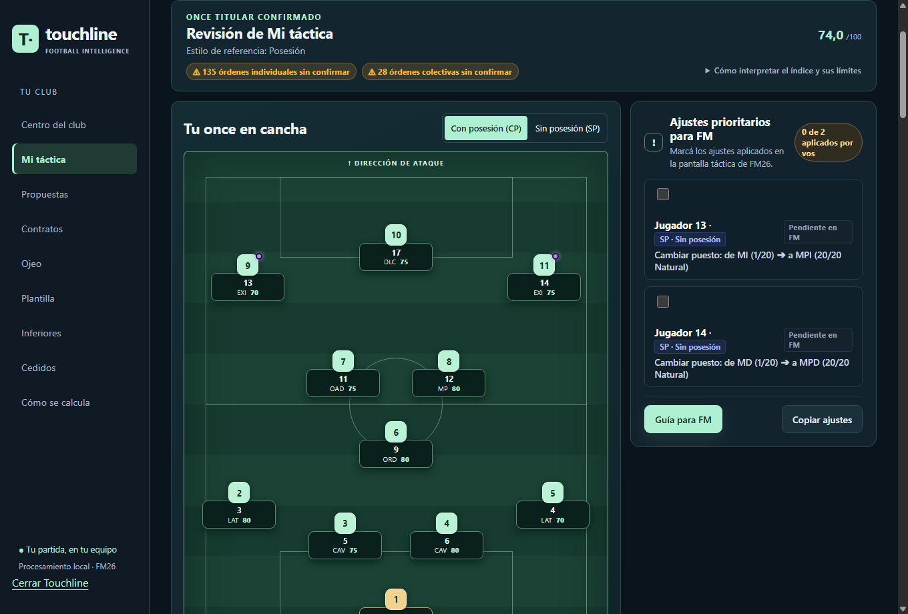
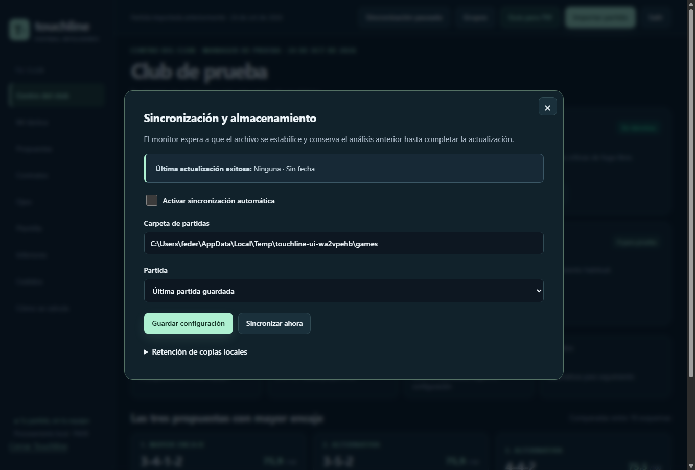
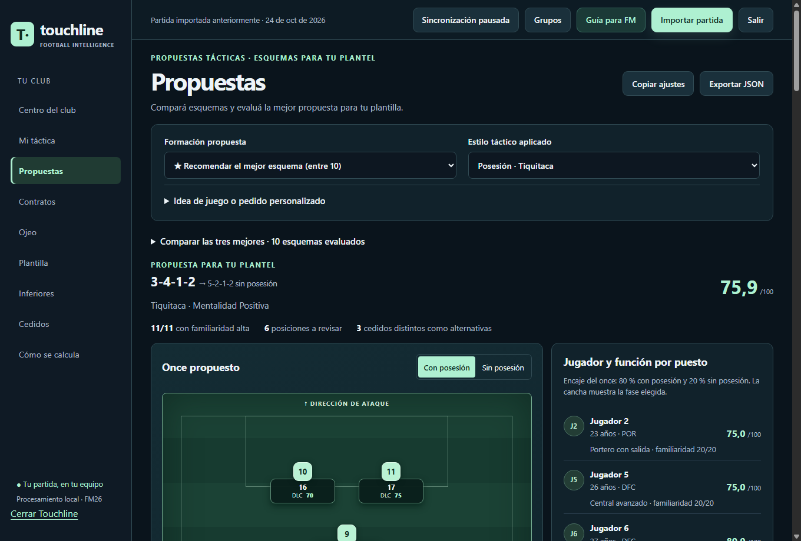
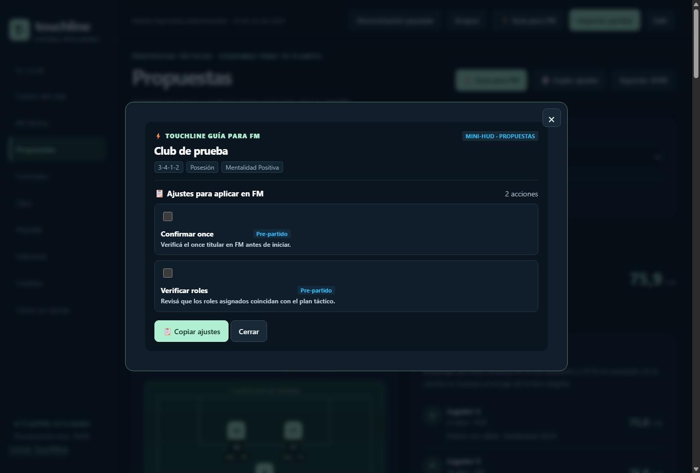
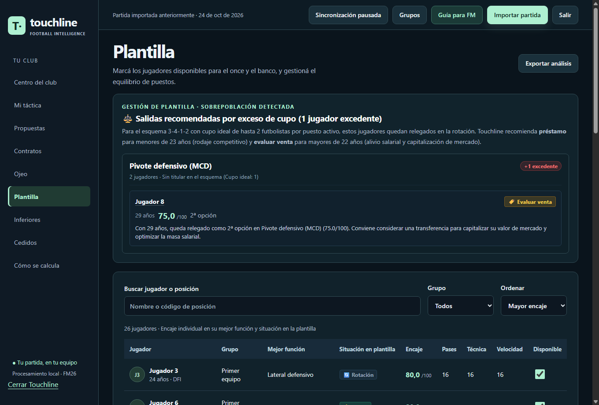
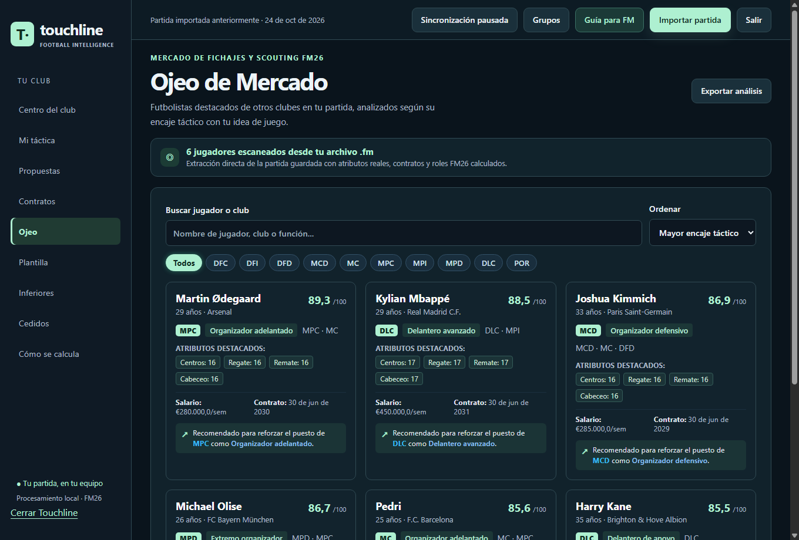

# Touchline · Analizador para Football Manager 26

Leé tu partida, revisá tu esquema con y sin pelota y compará alternativas para tu plantel. **Touchline** es una aplicación de escritorio para Windows que procesa los archivos `.fm` en tu PC.

[](https://github.com/Fede1771/Analizador-FM/releases/latest/download/Touchline-Analizador-FM26.msi)

[Descargar instalador](https://github.com/Fede1771/Analizador-FM/releases/latest/download/Touchline-Analizador-FM26.msi) · [Versiones y novedades](https://github.com/Fede1771/Analizador-FM/releases) · [Documentación](docs/README.md) · [Reportar un problema](https://github.com/Fede1771/Analizador-FM/issues)



## Empezar a usar Touchline

1. **Descargá el MSI** desde el botón de arriba. Si ya usás Touchline, cerralo antes de instalar la actualización.
2. **Ejecutá el instalador.** Se instala para tu usuario; no necesitás instalar Python ni las dependencias de desarrollo.
3. **Abrí Touchline** desde el Escritorio o el Menú Inicio.
4. **Cargá tu partida.** Usá **Importar partida**, arrastrá un archivo `.fm` o configurá la sincronización automática.
5. **Entrá en Mi táctica** y pulsá **Cargar táctica de la partida**. Revisá el once y los datos cargados antes de confirmar el análisis.

### Qué cambió en la versión 1.0.2

El lector táctico decodifica ahora la estructura binaria real de `tactics_man` en FM26, con independencia del club, del nombre de los jugadores y del nombre de la táctica:

- **Roles activos reales en ambas fases:** se lee la palabra de rol+tarea del pie de cada `_SlotBlock` (`settings[-1].second_bits_high | (trail_bits << 32)`) filtrando la máscara de tarea (`0x06E00000`), evitando confundir entradas antiguas del historial de `TacticSettingUnit` (`role_bits`) con el rol activo.
- **Permutación entre fases (`out_of_possession_position_index`):** vincula cada titular con su puesto de destino sin posesión (`oop_slot = by_number[oop_index]`), soportando rotaciones y ciclos de tres o más puestos.
- **Instrucciones individuales (`pi_mask`) y colectivas (`team_instruction_06..17`):** recupera las órdenes individuales del rol activo por puesto y las 28 dimensiones colectivas del equipo directamente del guardado.
- **Separación de origen del valor y disponibilidad del control:** la interfaz diferencia explícitamente si un valor fue `📥 Leído del guardado`, `🔒 Definido por el rol`, `✍️ Confirmado manualmente` o `💡 Recomendación`, por separado de la evidencia sobre el control (`🔒 Bloqueado comprobado`, `⚙️ Editable comprobado`, `❓ Disponibilidad no verificada`).
- **Conservación de ajustes manuales por carrera:** las órdenes confirmadas manualmente se preservan al actualizar el lector o sincronizar un nuevo guardado de la misma carrera, sin mezclar carreras distintas.

Consultá las [notas de la versión 1.0.2](docs/releases/1.0.2.md) para conocer las verificaciones y los límites de esta lectura.

## Qué podés hacer

| Sección | Para qué sirve |
| --- | --- |
| **Centro del club** | Consultar un resumen del plantel y del análisis de la partida cargada. |
| **Mi táctica** | Cargar el esquema, la selección guardada, los roles y las instrucciones de ambas fases, y revisar el once. |
| **Propuestas** | Comparar las tres estructuras de mayor encaje entre diez formaciones y simular alternativas. |
| **Plantilla e inferiores** | Revisar cobertura por puesto, sobrepoblación y posibles promociones de juveniles. |
| **Cedidos** | Consultar jugadores a préstamo y comparar alternativas de regreso cuando hay datos disponibles. |
| **Contratos** | Detectar vencimientos y priorizar decisiones de renovación o venta. |
| **Ojeo** | Filtrar y comparar objetivos cuando la importación dispone de datos de ojeo. |
| **Guía para FM** | Tener a mano las indicaciones y los ajustes del análisis mientras jugás. |

## Cargar y sincronizar tu partida

Touchline monitorea por defecto la carpeta habitual de partidas:

```text
Documentos\Sports Interactive\Football Manager 26\games
```

Desde el control de sincronización de la barra superior podés cambiar la carpeta, pausar el monitoreo o solicitar una sincronización. El botón muestra el estado actual, por ejemplo **Monitoreando guardados** o **Sincronización pausada**.

Si usás varias carreras, elegí un archivo específico para evitar que se cargue otra partida al detectar el último guardado modificado. También podés seleccionar una carpeta en otro disco.



El análisis se actualiza en segundo plano cuando se detecta un guardado terminado. Si una importación falla, se conserva el último análisis disponible.

## Revisar tu táctica

1. Abrí **Mi táctica → Cargar táctica de la partida**.
2. Si aparecen varias **copias guardadas**, elegí la que usás en FM.
3. Alterná entre **Con posesión (CP)** y **Sin posesión (SP)** para ver el esquema de cada fase. Podés tocar un puesto de la cancha para editarlo.
4. Cotejá los jugadores, posiciones, roles e instrucciones cargados desde tu partida. Podés modificar o confirmar manualmente cualquier orden antes de ejecutar la revisión.
5. Confirmá el once y pulsá **Revisar mi táctica** para obtener el índice de encaje, las observaciones y el mapa de cobertura por zonas.

La revisión conserva los jugadores y roles que confirmaste. Las alternativas de rol o de suplente se presentan como sugerencias separadas.

### Qué recupera el lector y qué queda pendiente

| Dato | Comportamiento actual |
| --- | --- |
| Posiciones, costados y permutación entre fases | Se leen de las máscaras de posición (`PositionMask`) y del índice de destino sin posesión (`out_of_possession_position_index`) del guardado. |
| Jugadores del once | Se recupera la selección guardada del equipo (`selectors[:11]`), conservando los puestos vacíos en su posición. |
| Roles de ambas fases | Se decodifica el rol activo real desde el pie de cada `_SlotBlock` filtrando los bits de tarea (`DUTY_MASK = 0x06E00000`). Si un código fuese desconocido o incompatible con el puesto, queda pendiente sin inventar un reemplazo. |
| Instrucciones individuales y colectivas | Se decodifican las 15 órdenes individuales por puesto desde la máscara `pi_mask` de la entrada activa de `TacticSettingUnit` (`FM.UI.PlayerInstruction`) y los 28 ejes colectivos desde el vector de bits `team_instruction_06..17` (`FM.UI.TacticTeamInstructions`). Si una orden `marking_target_oop` es `Mark Specific` o `Mark Position`, el rival o puesto concreto debe indicarse en el editor. |
| Táctica activa | Si hay una sola copia del grupo, se selecciona automáticamente. Si hay varias copias guardadas, podés elegir cualquiera en el selector **Copia guardada**. |
| Origen del valor vs. disponibilidad del control | La interfaz distingue el **origen del valor** (`📥 Leído del guardado`, `🔒 Definido por el rol`, `✍️ Confirmado manualmente`) de la **disponibilidad del control en FM26** (`🔒 Bloqueado comprobado`, `⚙️ Editable comprobado`, `❓ Disponibilidad no verificada`). |

La selección del archivo refleja el momento en que guardaste. Si cambiaste el once dentro de FM, guardá nuevamente para que Touchline pueda actualizarlo.

## Comparar propuestas para tu plantel

En **Propuestas**, el motor evalúa diez formaciones y muestra las tres con mayor índice de encaje. Podés elegir otra estructura, cambiar el estilo de referencia o ajustar las instrucciones para comparar resultados.

Cada propuesta incluye un once, alternativas de banco y observaciones sobre necesidades del plantel. Los estilos disponibles son posesión, presión alta, transiciones y juego por bandas.



### Cómo interpretar los resultados

El **encaje de 0 a 100** es un índice propio de Touchline que combina atributos, familiaridad posicional y estilo. No representa un porcentaje de victorias ni una calificación oficial de FM. El once pondera un 80 % de encaje con posesión y un 20 % sin posesión.

El mapa de cobertura es una estimación estática de apoyos por zonas. No reproduce el motor de partidos ni incorpora por sí solo al rival, el balón o la evolución de una jugada. Contrastá las recomendaciones con lo que observás en el juego.

Podés consultar la fórmula desde **Cómo se calcula** o leer la [explicación de táctica actual y cobertura](docs/tactica-actual-y-zonas.md).

## Consultar la guía mientras jugás

El botón **Guía para FM** abre una vista compacta para consultar los ajustes del análisis y llevar un registro de los que aplicaste. Los cambios tácticos se realizan dentro de Football Manager.



<details>
<summary>Ver capturas de plantilla y ojeo</summary>

### Plantilla y cobertura



### Ojeo



Las capturas son ejemplos de la interfaz. Los jugadores, las alertas y las opciones disponibles dependen de los datos de tu importación. Podés ver más ejemplos en la [galería de capturas](docs/capturas-finales/README.md).

</details>

## Compatibilidad y datos locales

- **Plataforma:** aplicación de escritorio para Windows.
- **Partidas:** archivos `.fm` de hasta 400 MB, compatibles con el lector de FM26. La importación actual requiere un único club gestionado.
- **Lectura táctica 1.0.2:** verificada con FM26 26.3.2 y copias de partidas reales de Liverpool, Brighton y Manchester United. La compatibilidad con otros formatos o actualizaciones del juego depende del lector.
- **Procesamiento local:** las partidas se leen y analizan en tu PC; no se suben a servidores externos para realizar el análisis.
- **Archivos originales:** Touchline trabaja sobre copias locales y conserva importaciones para poder restaurar el análisis. No escribe cambios en tu partida original.

En la versión instalada, los datos y registros se guardan en `%LOCALAPPDATA%\Touchline\data`. Al ejecutar desde el código fuente, se usa la carpeta `data/` del proyecto. Esos archivos personales están excluidos del repositorio.

## Resolver problemas habituales

| Situación | Qué revisar |
| --- | --- |
| No aparece mi partida | Comprobá la carpeta configurada o usá **Importar partida** para elegir el `.fm` directamente. |
| Se carga otra carrera | Fijá el archivo que querés monitorear en la configuración de sincronización. |
| Una importación anterior no muestra el esquema | Actualizá a 1.0.2 y pulsá **Cargar táctica de la partida**. Si ya no existe su copia local `.fm`, importá nuevamente el archivo. |
| Faltan titulares | Revisá si había puestos vacíos en la selección guardada de FM y guardá de nuevo después de completar el once. |
| Marcaje a jugador o puesto específico | Cuando el guardado activa `Mark Specific` o `Mark Position`, indicá el nombre del jugador o el puesto rival en el subcontrol del editor. |
| La partida resulta incompatible | Consultá el mensaje de error y el registro de extracción; el último análisis válido se conserva. |

Para [reportar un problema](https://github.com/Fede1771/Analizador-FM/issues), indicá la versión de Touchline y de FM, el paso que falla y el mensaje recibido. Una captura y el registro correspondiente de `data/logs/` o de la carpeta de importación ayudan a reproducirlo; no hace falta publicar tu partida completa.

## Ejecutar desde el código fuente

Esta sección es para desarrollo. Para usar Touchline normalmente, descargá el MSI.

Requisitos: **Python 3.12 o superior** en Windows. Desde la raíz del repositorio, en PowerShell:

```powershell
py -3.12 -m venv .venv
.\.venv\Scripts\python.exe -m pip install -r scripts/requirements-lock-windows.txt
.\.venv\Scripts\python.exe -B app_desktop.py
```

### Verificaciones

```powershell
.\.venv\Scripts\python.exe -B -m unittest discover -s tests -v
node --test tests/frontend.test.mjs
node tests/browser.test.mjs
```

Las pruebas del frontend requieren Node.js; las pruebas de navegador también requieren Chrome o Edge. Se pueden configurar las rutas con `PYTHON_BIN` y `CHROME_BIN` para estas últimas.

### Generar el instalador

La compilación requiere PyInstaller, WiX y la extensión `WixToolset.UI.wixext`. El MSI 1.0.2 se verificó con WiX 4.0.6 y su extensión 4.0.6.

```powershell
.\.venv\Scripts\python.exe -B tools/build_installer.py --version 1.0.2
```

El resultado se guarda en `dist/Touchline-Analizador-FM26.msi`. Consultá las [herramientas de compilación y verificación](tools/README.md) para configurar `WIX_EXE` e inspeccionar el instalador.

## Documentación del proyecto

- [Arquitectura](docs/arquitectura.md).
- [Lectura táctica, instrucciones y cobertura por zonas](docs/tactica-actual-y-zonas.md).
- [Referencia de FM26](docs/fm26-reference.md).
- [Notas de la versión 1.0.2](docs/releases/1.0.2.md) y [1.0.1](docs/releases/1.0.1.md).
- [Scripts disponibles](scripts/README.md) y [herramientas auxiliares](tools/README.md).
- [Índice completo de documentación](docs/README.md).
